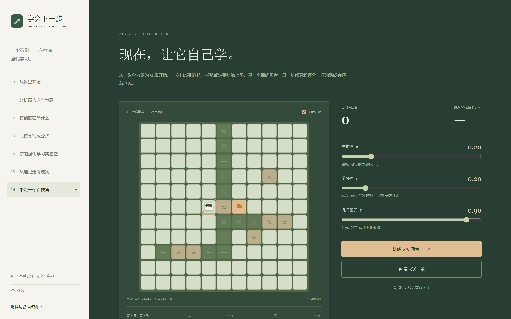
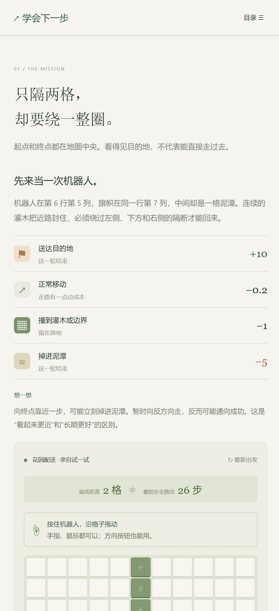

# 学会下一步 · 强化学习互动指南

[在线体验](https://www.lapgym.cn/rl/)

双击「学会下一步_触控互动版.html」即可使用。它是完整的单文件网页，包含图片、样式、教学内容与真实训练逻辑，无需联网、安装软件或账号。原始论文与课程的外部链接需要联网。原有「强化学习互动指南」「绕行挑战版」文件也同步更新为相同内容。

## 项目预览

### 花园绕行与训练

### 手机端学习界面

## 内容

- 绕行花园案例：11×11 地图，起点与终点均在中央，相距两格；近路被灌木和泥潭隔断，最短安全路线需26步，必须经过两侧边缘和下方通道。用方向按钮或聚焦地图后的键盘方向键亲自尝试。
- 学习循环：状态、动作、奖励与策略。
- 四个公式：折扣回报、价值与 Bellman、Q-learning 更新、ε-greedy；支持参数调整和数字计算。
- 浏览器内真实 Q-learning：可调整探索率、学习率、折扣因子；查看 Q 值、学习曲线与配送路线。
- 1957–2025 年的 12 个里程碑，每项附成果、边界和原始资料。
- 三道理解题与教材、课程入口。

## 实验说明

“亲自试一试”支持手机手指、电脑鼠标、方向按钮和键盘四种操作。按住机器人当前所在的格子，沿想走的路线连续拖动，松手即停。快速拖动仍会逐格计算奖励，不会穿过障碍；撞到灌木会停住，手指或鼠标移回机器人所在格后可以换方向。进入泥潭或终点会立即结束本轮。机器人以外的地图区域可以正常滑动页面；操作过程中也可重新出发。

每次“训练”增加500个回合，每回合最多300步。参数改变不会清除旧经验；公平比较前请点“清空经验”。训练包含探索，配送演示不探索，所以训练送达率和演示结果可以不同。刷新页面会重置实验。固定随机种子为42；默认参数500回合后，贪心策略学得26步安全路线，未折扣累计奖励+5，最近50回合训练送达率66%。结果只对应此教学环境。

推荐体验顺序：先直接向右，观察掉入近路泥潭；重新出发尝试绕行；然后训练500回合并观看配送。默认学到的路线是先左4步、下4步、右10步、上4步、左4步。该路线完全由训练得到，演示不会读取预设路线。

公式页同步用这26步计算：前25步各−0.2，最后一步+10。γ=.9 时折扣回报约−1.14，γ=.97时约1.12，γ=1时为5。负回报不代表配送失败，成功与否由是否到达旗帜判断。

## 项目文件

dist/ 是可部署的静态网页源文件。research/ 保留原始资料、引用与内容审核说明。tests/ 验证环境规则和训练核心。有 Node.js 的开发者可运行 npm test、npm run build、npm start；本地预览地址 http://127.0.0.1:4173。

配图使用内置AI图片生成功能生成。教学地图与配图为示意，不代表真实机器人能力。数学参考 Sutton & Barto（2018）、Watkins & Dayan（1992）；所有历史节点注明各自来源。资料整理日期：2026-10-30。

